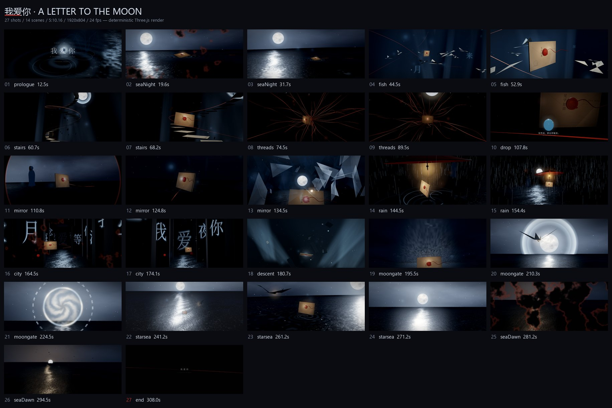
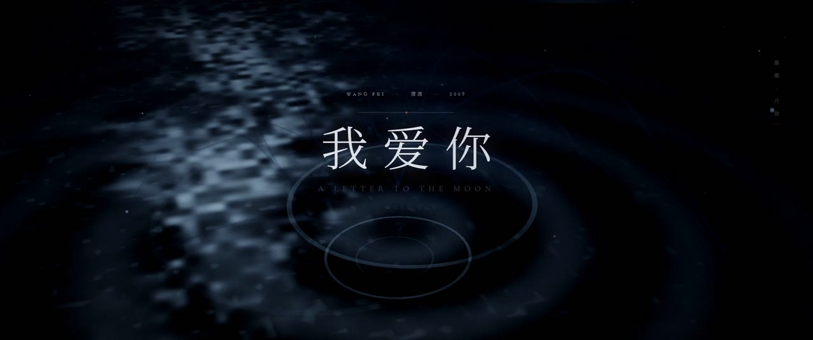
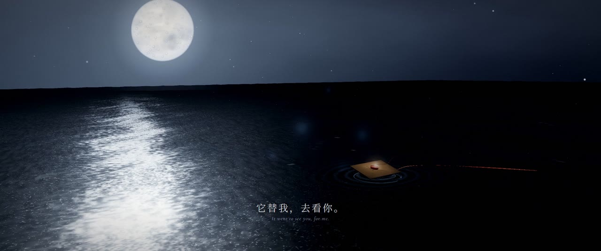
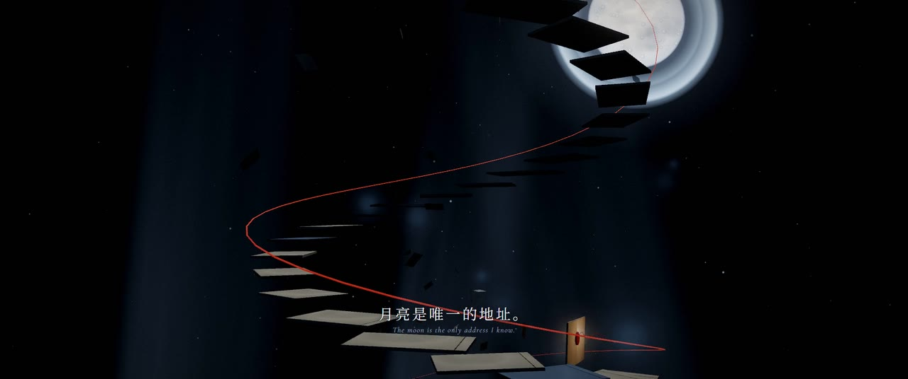
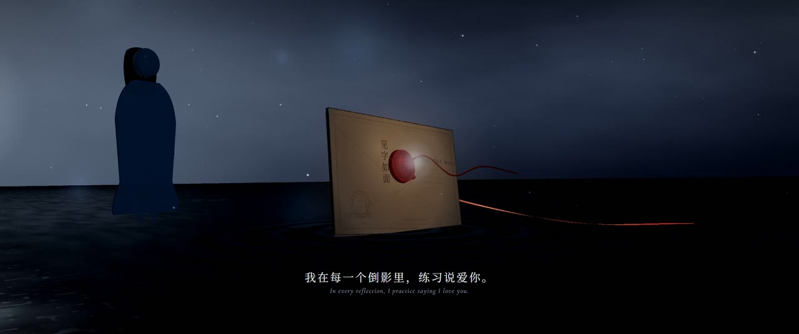
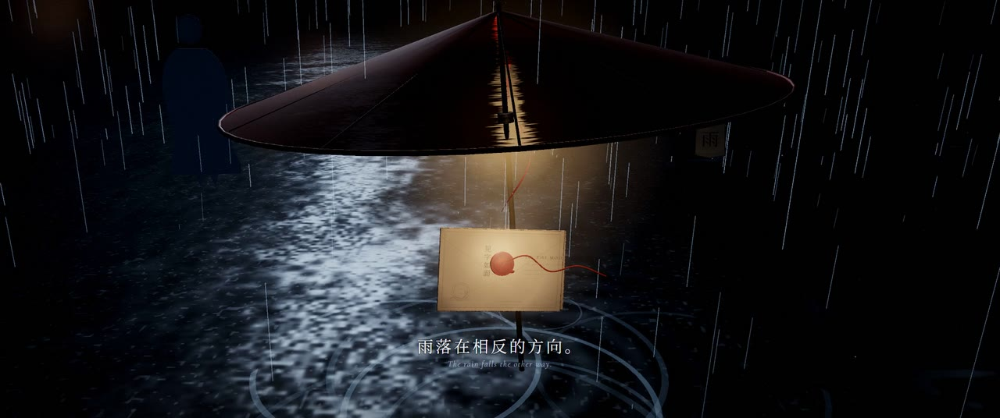
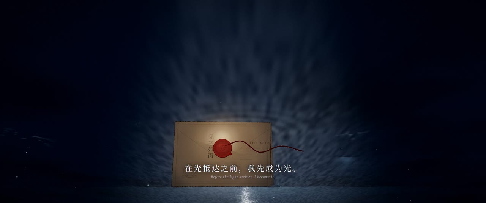
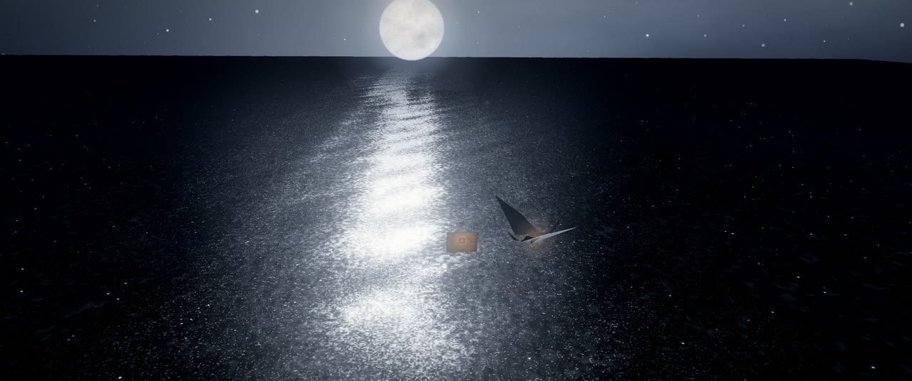
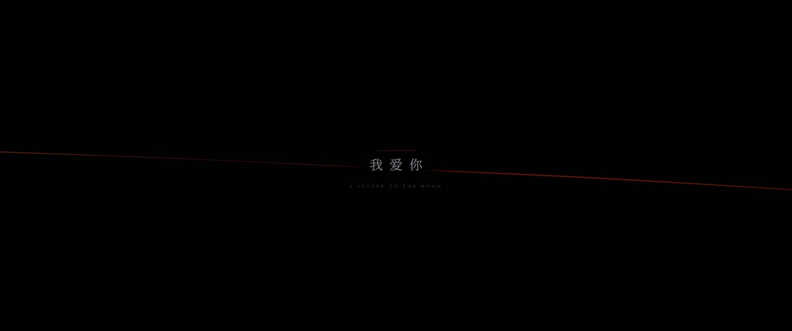

# 概念 · Concept

> 一首歌 + 一句话 → 一部有导演意图的 MV。
> 先做导演决策，再写渲染代码。

---

## 一、项目概念

### 一句话

mvcraft 是一层**导演方法**：把「好听、好看、耐看」拆成可执行、可校验、可复现的工序，
并附带一套能跑的 Three.js 参考实现。

### 它不是什么

| 不是 | 为什么 |
|---|---|
| 不是实时可视化 / 节拍模板 | 律动只是素材，叙事和镜头才决定片子好不好看 |
| 不是「一键出片」 | Gate A/B/C/D 需要人确认；跳过确认的代价在后面加倍 |
| 不是渲染器 | 渲染交给 three.js；本项目只管「怎么拍」和「怎么验」 |
| 不是提示词大全 | 提示词只能生成画面，不能生成节奏、镜头语法和统一风格 |

### 三层结构

```
方法层   SKILL.md + references/    怎么问、怎么定风格、怎么分镜、怎么验收
工具层   tools/                    音频分析、分镜校验、截图探针、逐帧导出、时序 QA
样片层   examples/                 27 镜 / 14 场景的完整可运行参考
```

方法层是主体。工具和样片是「这套方法确实能跑」的证据。

---

## 二、参考片概念

### 《我爱你 · A LETTER TO THE MOON》

**Logline**：一封没有寄出的信，穿过墨海、纸阶与月光，最后成为星星。

**母题**：信 → 月亮 → 星星。信是「想说但没说出口」，月亮是「唯一的地址」，
星星是「话终于散开，成了光」。

**情绪曲线**：压低（序）→ 离开（主歌一）→ 上升（副歌一）→ 屏息（息）→
镜像与雨（主歌二）→ 坠落与星（副歌二）→ 渡月（桥段）→ 归来（终章）。

> 本片是为王菲《我爱你》（2009《潜流》）做的**非商业影像习作**。
> 仓库不包含原曲音频与歌词；字幕为原创诗行。

### 视觉规则（锁定后不再改）

| 项 | 规则 |
|---|---|
| 色板 | 墨黑 `#06080d` · 深海蓝 `#1b2433` · 银 `#c9d3e0` · 宣纸 `#e8e2d4` · 火漆红 `#b3342c` |
| 红色的用法 | 只出现在火漆、绳、印；单帧面积 <5%，它是全片的「心跳」 |
| 材质 | 纸（纤维、微透光）、墨（半透明、边缘扩散）、银（低粗糙度无彩色反射）、蜡（次表面感） |
| 光 | 顶柔光 5600K，低对比 0.6–0.75；月亮是唯一硬光源 |
| 镜头 | 35/50/85mm；慢推、环绕、升降；抖动 0.02–0.05；禁止快速变焦 |
| 字 | 思源宋体 300 + Cormorant Garamond Italic；字距 +0.08em；字幕不进 3D |
| 后处理 | Bloom 0.28 @ 0.82；颗粒 0.035；暗角 0.35；色差 0.0008 |
| 黑位/白位 | 黑位 0.01–0.02（带蓝），白位 0.95 |

### 结构（8 段 · 27 镜 · 14 场景 · 310.16s）

| 段落 | 时间 | 能量 | 镜头 | 事件 |
|---|---|---|---|---|
| 序 · 墨起 | 0–19.1 | 0.12 | 1 | 片名；墨在海面扩散 |
| 主歌一 · 海上 | 19.1–60.2 | 0.38 | 4 | 信封浮出；纸鱼引路 |
| 副歌一 · 上升 | 60.2–104.04 | 0.62 | 5 | 纸阶向上；红线生长、俯冲 |
| 息 | 104.04–110.33 | 0.08 | 1 | 全片唯一的静场；火漆特写 |
| 主歌二 · 镜与雨 | 110.33–157.0 | 0.46 | 5 | 镜屋倒影；逆流的雨 |
| 副歌二 · 坠与星 | 157.0–205.0 | 0.72 | 5 | 字城下坠；穿过光 |
| 桥段 · 月渡 | 205.0–254.0 | 0.58 | 4 | 月下飞行；穿过月门 |
| 终章 · 潮归 | 254.0–310.16 | 0.35 | 2 + 片尾 | 星海成形「我爱你」；回到海面；片尾卡 |

切点规则：至少 60% 落在 onset 或拍网格 80ms 内；峰值前 1–2 拍切；
转场以切点为中心；非转场黑场 <0.5s。

实测：onset 命中 42%，拍网格 62%，**联合命中 92%（24/26）**。

---

## 三、效果图

全片 27 镜（每镜取一帧，三处转场黑场换成代表帧）：



关键静帧（1280×536）：

| | |
|---|---|
|  |  |
|  |  |
|  |  |
|  |  |

### 可复现的数字

| 项 | 值 |
|---|---|
| 时长 / 帧率 / 画幅 | 310.16s / 24fps / 1920×804（2.39:1） |
| 帧数 | 7444 |
| 渲染 | Chromium headless + ANGLE D3D11，39–54 ms/帧，5.7–6.7 分钟 |
| 运行时错误 | 0 |
| 切点联合命中 | 92% |
| VMAF（JPEG 帧 vs 成片，前 2s） | mean 90.97 / min 85.43 |
| 成片 | H.264 High · yuv420p · tv range · BT.709 · AAC 256k · faststart |

---

## 四、为什么这样设计

| 选择 | 理由 |
|---|---|
| 纯 `render(t)` 确定性渲染 | 同一时间点像素一致，才能做逐帧 diff、断点续渲、VMAF |
| 字幕走 Canvas 2D 叠加 | 不参与景深/遮挡/色调映射，字永远清楚 |
| `storyboard.json` 是唯一真相源 | 代码、animatic、剪辑表都从它生成，避免两处时间不一致 |
| 不引入 React / GSAP / 后处理大库 | 少一个依赖，少一种失败方式；three.js `examples/jsm` 够用 |
| 锁定 `art-direction.json` | 风格漂移是长片最大的隐形损耗 |
| 每章末「抄作业」表 | 轮子直接用，时间花在导演决策上 |

---

## English summary

**mvcraft** turns *a song + one line* into a cinematic music video by treating
direction as an engineering process: intake questions, a music map, a locked art
direction, a storyboard schema, camera grammar, deterministic Three.js rendering,
and temporal QA. The bundled reference film (27 shots, 14 scenes, 5:10) is a
non-commercial visual study; its audio and lyrics are **not** included. Code MIT,
docs CC BY 4.0.
